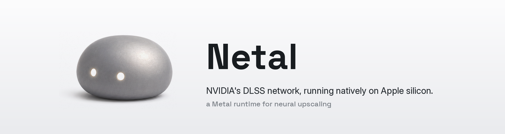

<p align="center"></p>

# Netal

A native Metal neural-graphics runtime and macOS app. Netal's Super Resolution
and native neural Frame Generation have worked inside Resident Evil Requiem
through CrossOver.

**Experimental complete-source release.** This tree includes the actual SR/FG
implementations, bridges, app and test lab. It is a research source release;
installation still requires the explicit local inputs described below.

Credit to [WaveCut / MLX-DLSS](https://github.com/iamwavecut/MLX-DLSS) for pioneering
DLSS on Apple silicon. Both projects have real neural FG. Netal focuses on runtime
reconstruction and live game integration; no blanket first-on-Mac claim is made.
Nico's [The beginning of DLSS on Mac](https://x.com/nos_ult/status/2095675277003415896)
describes the runtime work and includes Resident Evil footage.

## What is included

- Native SR session, model layouts/repacking, reference and accelerated body code,
  boundary/texture kernels, and explicit-input local bundle assembly.
- Native FG runtime, 73 shader build variants, Metal 3/4 integration, game
  adapters and full-resolution compositing.
- arm64 native-game and x86_64 CrossOver bridges, launch/import helpers, and the
  menu-bar app.
- Controlled test harnesses, source-build recipes, contributor/CI policies and
  five hash-pinned, model-independent scalar calibration data files.

NVIDIA DLLs, model weights, SDK headers, compiled runtime libraries, game assets,
private captures and research Git history are not included. The original
research repository is preserved privately and is not the history of this tree.

## Supply the exact supported DLLs

Users must obtain their own permitted copy of the supported input. Both tested
DLLs report **file version 310.8.0.0**, but the complete SHA-256 is authoritative:

| Feature | File | Tested SHA-256 |
| --- | --- | --- |
| SR Preset K | `nvngx_dlss.dll` | `c85f971ce023c9f3492fc7455f0b01a24ba18ea39636407a846902c4360b0b7e` |
| FG | `nvngx_dlssg.dll` | `5d5cbf14d2727d47f93fd10bf77bd91708ae122482a6f86fd564971641ebd47b` |

An arbitrary, newer or same-named DLL is not automatically supported. Do not
upload DLLs or extracted weights in issues or PRs. [Model setup](docs/MODEL_SETUP.md)
explains the tested SR import path and the remaining FG provisioning boundary.

**This is not yet a one-click DLL-to-game installation.** SR assembly still
requires four explicitly supplied scalar-contract tables. FG requires the 67
supported post-evaluate model buffers; a complete Mac-only extraction path is
not verified. Those dependencies are not replaced with fake data or silently
downloaded. See [complete source build](docs/COMPLETE_SOURCE_BUILD.md).

## Build and test

Use Apple silicon with an appropriate Xcode/macOS SDK and Metal toolchain. The
app deployment target is macOS 14; current game-runtime APIs target macOS 26,
and the measured development configuration is M3 Max.

```sh
zsh scripts/build-macos-netal-menubar.sh
zsh scripts/test-macos-netal-menubar.sh
python3 scripts/test-fg-offline-sequence.py
python3 scripts/test-netal-sr-source-assembly.py
python3 scripts/build-netal-fg-engine.py --output /new/path/fg-engine
```

The source-build guide covers all SR kernels, local runtime assembly and both
game bridges. Source app builds use local ad-hoc signing. Menu-bar app preview
downloads, when available, are listed under [Releases](https://github.com/nschlaepfer/Netal/releases)
with their signing status. The app download does not include the separate game
runtime or model inputs. No model download or universal game-support claim is provided.

## Evidence and limitations

Historical RE9/CrossOver telemetry reaches 38,474 generated FG frames with zero
logged FG fallbacks and SR scheduled frame 10,200. The maintainer observed good
SR and FG gameplay. These counters are not independent displayed-FPS measurements.
The internal FG network is 640×360, with game-resolution compositing.

The clean source build compiled all 73 FG variants, 11 SR reference kernels,
six SR boundary kernels and both bridges. Its rebuilt FG engine reproduced all
96 recorded frame records across six procedural scenes. Its assembled SR bundle
matched four retained 1080p RTX reference outputs exactly with intact canaries,
using explicitly supplied local model/scalar/reference data.

Known occlusion tests still fail: 5/15 generated frames in one case and 15/15 in
linear motion. Fast hardware arithmetic is approximate; narrow reference matches
are not universal exactness. NR remains experimental. Current installation,
broader device/game coverage, temporal edge cases and presentation measurements
remain separate work. [Status](docs/STATUS.md) records the boundaries.

## Contributing and source origin

Read [CONTRIBUTING.md](CONTRIBUTING.md) and [repository governance](docs/REPOSITORY_GOVERNANCE.md).
CI distinguishes app behavior, engine compilation and contribution-content checks.
It does not execute games or establish GPU parity.

Original project code uses the included [MIT license](LICENSE), subject to
specific notices. CuMetal helper code has Apache-2.0 attribution. Twenty-two
retained shaders are explicitly marked as translations of runtime input; their
distribution basis remains unresolved in [the source-origin review](docs/SOURCE_PROVENANCE_REVIEW.md).
Publication and successful builds do not establish third-party distribution
rights or extend the MIT license to translated inputs.

Netal is independent of NVIDIA, Apple and CodeWeavers. DLSS is an NVIDIA trademark.
