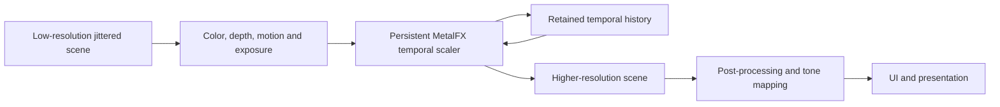

# Apple upscaling and comparable implementations

Checked 2026-11-08. This note separates public API/source facts from measurements
on the current A20 Pro. No third-party model or shader payload was imported.

## MetalFX pipeline inspection

MetalFX is Apple's upscaling framework; Metal 4 is its command/resource platform.
The public temporal integration flow is:

This shows the integration contract, not Apple's private network layers.
Spatial scaling needs color only; temporal scaling also needs valid motion,
depth, jitter and history/reset semantics. The denoised scaler and frame
interpolator are separate effects, not extra rendered/simulation FPS.
[Apple MetalFX documentation](https://developer.apple.com/documentation/metalfx).

Public ways to avoid unnecessary work include creating/reusing the scaler and
private textures, rendering fewer scene pixels, using the required texture usage
flags and correct residency/barriers, and avoiding CPU pixel readback. Temporal
`requiresSynchronousInitialization = YES` prepares the optimized pipeline while
loading; its default can initially use a slower implementation during background
compilation. This does not precompile all game shaders.
[Initialization control](https://developer.apple.com/documentation/metalfx/mtlfxtemporalscalerdescriptor/requiressynchronousinitialization).

The newer backend combining Neural Engine and GPU Neural Accelerators is
specifically documented for M5 Pro/Max. Its availability and throughput cannot
be inferred for A20 from the shared accelerator terminology. Apple does not
publish this scaler's weights, layer graph or general precision controls.
[WWDC26 Metal guide](https://developer.apple.com/wwdc26/guides/metal/).

### Actual A20 comparison

An iPhone 18 Pro Max on iOS 27.2 completed both public Metal 4 scaler paths at
640×360 → 1280×720. A common normalized-world stimulus, 16 warm-up and 120
measured frames, nominal thermal state, and capture-disabled builds were used.
Timings include input buffer-to-texture copies, synchronization, scaling and
output texture-to-buffer copying. No Netal model session was allocated in these
cases.

| Backend | GPU p50 | GPU p95 | GPU p99 |
| --- | ---: | ---: | ---: |
| MetalFX spatial HDR | 0.813 ms | 1.173 ms | 4.029 ms |
| MetalFX temporal | 1.918 ms | 2.347 ms | 2.764 ms |

These are standalone scaler timings, not full-game FPS or equivalent-quality
claims. Both passed transfer-format checks, private-output RGB poison validation
and guard/finite-output checks. The current OoT hook provides color only, so the
temporal result does not establish a working game adapter.

### Capturing the pipeline

The optional comparison module supports a separate capture-enabled build and
one warmed frame to a private GPUTraceDocument. Performance measurements from
capture-enabled builds are refused. Traces can contain framework resources;
keep them and all raw data outside Git/PRs.
[Apple capture workflow](https://developer.apple.com/documentation/xcode/capturing-a-metal-workload-programmatically).

An actual A20 capture was copied locally and replayed in Xcode 27. Its dependency
view showed input-copy compute work, barriers, a **MetalFX Temporal Scaling**
framework node, and output-copy compute work. The framework node is opaque: two
visible wrapper encoders do not prove that the scaler internally uses only two
kernels. Temporal-history pixel replay correctness and hardware instruction
precision were not established by opening the trace.

Open a private trace in Xcode, select **Profile after replay**, then inspect
**Dependencies**, resources and available statistics. For broader CPU/GPU/display
and thermal behavior, use Instruments Metal System Trace. Capture/profiling can
perturb execution, so use ordinary uninstrumented runs for latency conclusions.
[Metal debugger](https://developer.apple.com/documentation/xcode/metal-debugger/).

## Would an MLX rewrite be faster?

It is a plausible competing backend, not a demonstrated win. The current
[MLX-DLSS SR implementation](https://github.com/iamwavecut/MLX-DLSS/blob/7870371e8bf6c03967213f1a5d40db6c5a3bee38/docs/super-resolution.md)
implements experimental Linux DLSS 310.7 K, LDR, fixed 2× reconstruction. Its SR
graph performs reference-oriented FP32 matrix chunks with FP16 handoffs. Its
headline FP8 performance results concern DLSS 5 neural rendering, a different
model/task. No matching A20 SR timing is published there.

Official MLX supports physical iOS and has NAX/MPP GEMM/attention paths plus
compile/fusion opportunities. Current core main
[`fc344c9`](https://github.com/ml-explore/mlx/commit/fc344c986c4169d99f76b5d95ae6b4a58a359a63)
uses packed uint8 FP8 storage; its quantized NAX paths dequantize operands into
floating tiles before MPP. That differs from this experiment's direct FP8-format
TensorOps inputs. MLX Swift main pins an older core snapshot, so latest Swift
and latest core are separate version choices.
[FP8 loaders](https://github.com/ml-explore/mlx/blob/fc344c986c4169d99f76b5d95ae6b4a58a359a63/mlx/backend/metal/kernels/fp_quantized_nax.h#L25),
[Swift dependency](https://github.com/ml-explore/mlx-swift/blob/5f117a2e7ee1ce92f8dcc1520bc07535c43846f9/Package.swift).

A useful MLX comparison would use the same model/geometry, GPU-resident history,
verified kernel selection and total synchronization/import/export costs. Shared
memory and graph fusion do not make those costs disappear. No full MLX port or
performance result is claimed by this PR.

## S2Arm findings

[S2Arm](https://github.com/jhaizhou-ops/S2Arm) has a substantial native runtime
and launcher around nxnative-derived graphics. Main was rechecked at
`49251943b8b3b0cc4d1642aef74c2dd4e00f01a2` (20:03:13 UTC); the recent six-commit
update changes launcher/setup tooling, not renderer/runtime performance.
[Comparison](https://github.com/jhaizhou-ops/S2Arm/compare/bd3ed90c047af38552fb6db4eb4de5585ed33e49...49251943b8b3b0cc4d1642aef74c2dd4e00f01a2).

Its generic NVN2 DLSS adapter supplies MetalFX temporal inputs, but the OoT
embedded-network path still uses a spatial stand-in with nil depth/motion. It
therefore does not establish the missing OoT temporal contract.
[OoT stand-in](https://github.com/jhaizhou-ops/S2Arm/blob/bd3ed90c047af38552fb6db4eb4de5585ed33e49/graphics/nvn/gfx/nvn/nvn_tensor.inc#L183-L185).

Its evidence page reports cold 60 FPS on A19 Pro, falling to roughly 37–43 FPS
under heat; this is maintainer evidence with incomplete scene/resolution/raw
receipts, not a sustained A20 result. The deferred-UBO interval index and demand
priority ideas merit separate measured experiments. Draw-skipping and risky
render-pass load suppression should not be imported as faithful speed gains.
No S2Arm code or app was installed by this Netal work.
[Evidence](https://github.com/jhaizhou-ops/S2Arm/blob/bd3ed90c047af38552fb6db4eb4de5585ed33e49/docs/validation/EVIDENCE.md).
